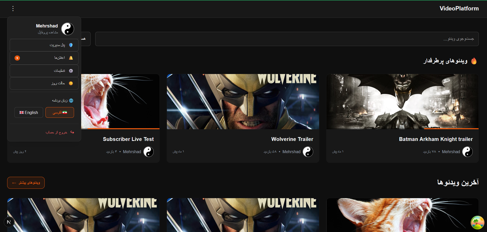
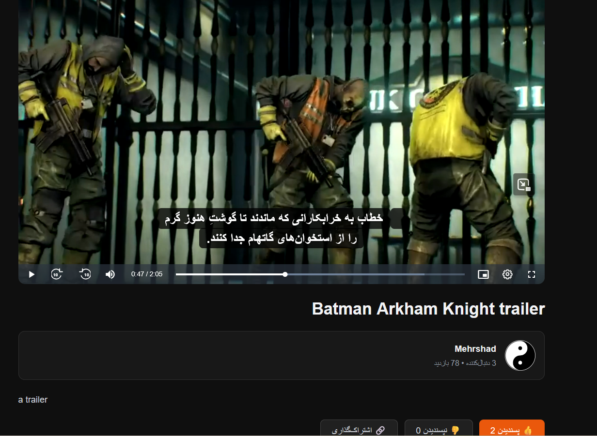
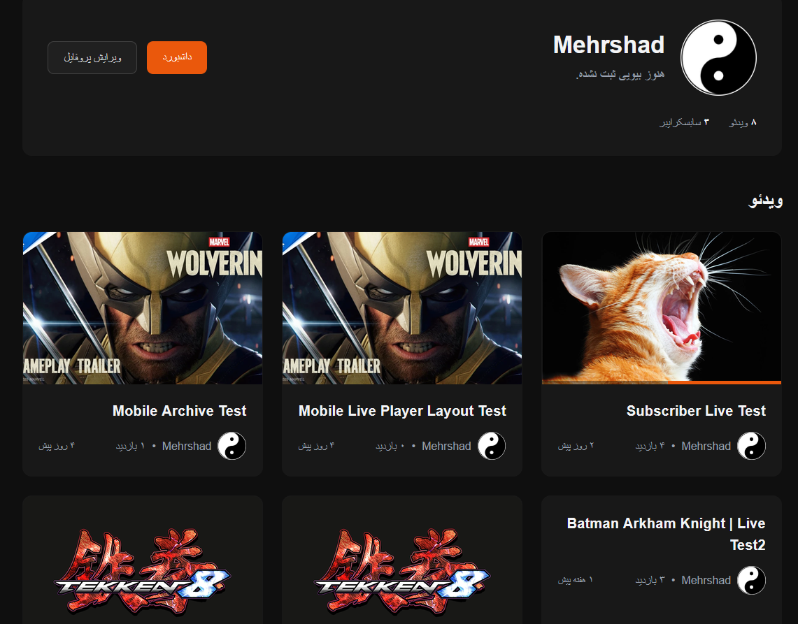
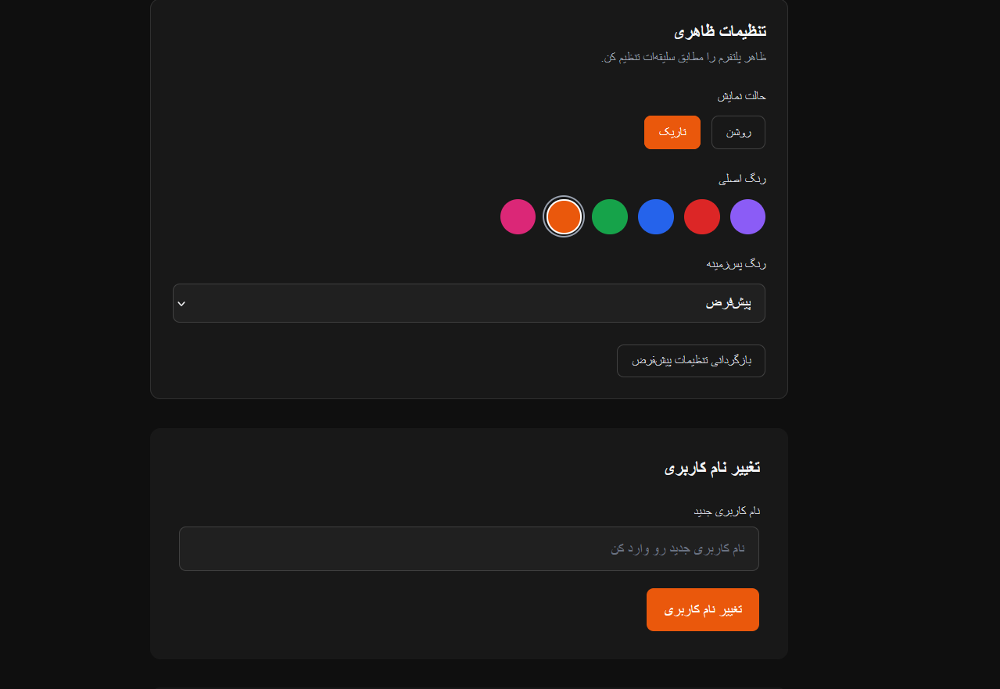

# VideoPlatform Frontend

A responsive video-sharing platform frontend built with Next.js, React, and TypeScript. It integrates with the companion Django REST Framework backend and includes video discovery, creator tools, live streaming, user interactions, notifications, and administrative moderation.

## Related repository

- **Backend:** [VideoPlatform-Backend](https://github.com/Mehr3had/VideoPlatform-Backend)
- **Frontend:** [VideoPlatform-Frontend](https://github.com/Mehr3had/VideoPlatform-Frontend)

- ## Screenshots

<table>
  <tr>
    <td width="50%" valign="top">
      
    </td>
    <td width="50%" valign="top">
      
    </td>
  </tr>
  <tr>
    <td width="50%" valign="top">
      
    </td>
    <td width="50%" valign="top">
      
    </td>
  </tr>
</table>

## Features

### Authentication and account management

- User registration and login with JWT authentication.
- Access-token refresh flow.
- Forgot-username and password-recovery workflows.
- Password and username management.
- Account deletion.
- Profile editing and account settings.

### Video discovery and playback

- Browse and search videos.
- Filter by category and explore trending content.
- Custom video player with playback controls.
- Selectable video quality options (480p, 720p, and 1080p when available).
- Playback speed and subtitle support.
- Double-tap seeking and playback controls.
- Persistent playback progress and elapsed/remaining-time display.

### User interaction

- Like and dislike videos.
- Create comments and nested replies.
- Like and dislike comments.
- Edit, delete, and report comments.
- Question-style comments and spoiler-related display support.
- Subscribe to channels and manage subscriptions.

### Live streaming

- Dedicated Live Studio for preparing and creating a live stream.
- Live viewing pages with channel avatar/profile and subscriber information.
- Subscribe to a channel from the live page (not shown to the channel owner).
- Live reactions, sharing, and live-stream reporting.
- Live chat with message count, username mention insertion, and message reporting.
- Pishi sticker picker with 24 static sticker assets.
- Custom HLS live player with a rolling DVR window, rewind, jump-to-live, live-delay indication, volume, fullscreen, and picture-in-picture controls where supported by the browser.

Live publishing and playback require the companion backend and a configured MediaMTX instance. See the [backend live-streaming setup](https://github.com/Mehr3had/VideoPlatform-Backend#live-streaming-setup).

### Creator dashboard

- Upload videos and thumbnails.
- Edit video information.
- Manage uploaded videos.
- Dedicated success pages for completed actions.

### Notifications

- Notifications for subscribed-channel activity, video likes, comments, and replies.
- Notification management and read status.
- Notification preference controls.

### Administration and moderation

- Admin dashboard.
- View and manage reported comments.
- Review live-stream reports and live-chat message reports.
- Review, dismiss, or take moderation actions on reports.
- Report filtering and statistics.

### Interface and architecture

- Responsive application layout.
- Persian/English interface strings.
- Light and dark appearance modes.
- Component-based UI organized by feature.
- Custom React hooks for application logic and data fetching.
- Centralized API clients.
- Shared client-state stores.

## Tech stack

| Technology | Purpose |
|---|---|
| Next.js 16.4.6 | App Router and application framework |
| React 19.2.8 | UI library |
| TypeScript | Static typing |
| Tailwind CSS 4 | Styling |
| Sass | Additional stylesheet support |
| Axios | HTTP requests |
| TanStack Query 5 | Server-state management |
| Zustand 5 | Client-state management |
| Video.js 8 | Video playback |
| ESLint 9 | Code linting |
| Django REST Framework | Companion backend API |

Exact frontend dependencies are recorded in [`package-lock.json`](package-lock.json).

## Prerequisites

- Node.js 24.21.0 (version used for local verification).
- npm 11.19.0 (version used for local verification).
- Git.
- The [VideoPlatform backend](https://github.com/Mehr3had/VideoPlatform-Backend).
- For live streaming: a running backend, MediaMTX configured for RTMP/HLS, and the backend webhook integration.

The backend must be running for authentication, videos, comments, subscriptions, notifications, and live-stream features that use the API.

## Getting started

### 1. Clone the repository

```bash
git clone https://github.com/Mehr3had/VideoPlatform-Frontend.git
cd VideoPlatform-Frontend
```

### 2. Install dependencies

```bash
npm ci
```

### 3. Configure the backend URL

Create `.env.local` in the frontend project root:

```dotenv
NEXT_PUBLIC_API_URL=http://127.0.0.1:8000
```

This value is the base URL of the Django backend. Change it if the backend is running at another address.

> Values prefixed with `NEXT_PUBLIC_` are exposed to the browser. Do not put passwords, private API keys, Django secrets, or other confidential values in this variable.

### 4. Start the backend

Follow the [backend setup instructions](https://github.com/Mehr3had/VideoPlatform-Backend#getting-started) and make sure Django is available at:

```text
http://127.0.0.1:8000
```

The backend's current development CORS and CSRF settings allow `http://localhost:3000`. Keep the browser frontend origin consistent, or update the backend settings for your own local origin.

### 5. Run the frontend development server

```bash
npm run dev
```

Open the application at:

```text
http://localhost:3000
```

## Live streaming development

The frontend includes two main live-stream routes:

- `/studio/live` — creator Live Studio.
- `/live/[id]` — live-stream viewing page for a stream ID.

To test live streaming locally:

1. Start Django and configure `LIVE_WEBHOOK_TOKEN` in the backend `.env` file.
2. Start MediaMTX with HTTP authentication connected to the backend's `/videos/api/live/mediamtx-auth/` endpoint.
3. Make sure the RTMP publisher listener and HLS listener are available to the publisher and browser respectively.
4. Configure MediaMTX lifecycle hooks to invoke the backend `mediamtx_webhook.py` script for online/offline events.
5. Open `/studio/live`, create a stream, and publish to the RTMP address using the returned one-time stream credential.
6. Open `/live/<id>` to watch and test live chat and player controls.

The local MediaMTX demo setup uses RTMP on `127.0.0.1:1935`, HLS on `127.0.0.1:8888`, and an HLS playlist configured for 35 segments of 2 seconds each (an approximately 70-second rolling window). Exact URLs and network access depend on your MediaMTX configuration. Do not commit or share stream credentials.

For the backend webhook, MediaMTX must provide `MTX_PATH` and `MTX_SOURCE_ID`, and the backend must be reachable from the MediaMTX process at the URL configured in `mediamtx_webhook.py`. See the [backend live-streaming setup](https://github.com/Mehr3had/VideoPlatform-Backend#live-streaming-setup) for configuration details.

## Production build and scripts

Run the TypeScript check:

```bash
npx tsc --noEmit
```

Run ESLint:

```bash
npm run lint
```

Create an optimized production build:

```bash
npm run build
```

Start the production server after building:

```bash
npm run start
```

Available npm scripts:

| Script | Command |
|---|---|
| `dev` | `next dev --webpack` |
| `build` | `next build` |
| `start` | `next start` |
| `lint` | `eslint` |

## Project structure

```text
src/
├── app/
│   ├── admin/
│   ├── dashboard/
│   ├── live/
│   ├── notifications/
│   ├── profile/
│   ├── settings/
│   ├── studio/
│   └── videos/
├── components/
│   ├── admin/
│   ├── auth/
│   ├── comments/
│   ├── dashboard/
│   ├── live/
│   ├── notifications/
│   ├── profile/
│   ├── providers/
│   ├── settings/
│   └── videos/
├── context/
├── hooks/
├── i18n/
├── lib/
├── stores/
└── types/

public/
└── stickers/
    └── pishi/
```

### Architecture overview

- `app/` — Next.js routes and pages.
- `components/` — reusable UI components grouped by feature.
- `context/` — shared React context.
- `hooks/` — application logic and data-fetching hooks.
- `i18n/` — translation resources.
- `lib/` — API clients and shared utilities, including sticker metadata.
- `stores/` — Zustand stores for shared client-side state.
- `types/` — TypeScript types and interfaces.
- `public/stickers/pishi/` — static Pishi sticker images used by live chat.

## Backend integration

The frontend communicates with the Django REST API. The API base URL is set by `NEXT_PUBLIC_API_URL` and used by the shared clients in `src/lib/`.

For the local development setup, the typical origins are:

- Frontend: `http://localhost:3000`
- Backend: `http://127.0.0.1:8000`
- MediaMTX RTMP: `127.0.0.1:1935`
- MediaMTX HLS: `127.0.0.1:8888`

The backend must allow the frontend's exact origin through its CORS and CSRF configuration.

## Media and local data

The backend's SQLite database and uploaded media are not included in this repository. A fresh setup may require you to create an account, add categories, and upload sample videos before all screens can be exercised. The 24 Pishi sticker images are static frontend assets and are included in this repository.

## Security notes

- Keep `.env.local` out of version control.
- Do not put private credentials in `NEXT_PUBLIC_` variables.
- Treat JWTs and live-stream publisher credentials as secrets.
- Configure HTTPS, backend CORS/CSRF, and MediaMTX network access appropriately before any public deployment.

## Project status

VideoPlatform is a full-stack learning and portfolio project under active development. Production deployment, operational monitoring, and comprehensive security testing are separate tasks.

## License

No license has been specified yet.
